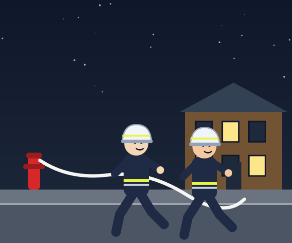
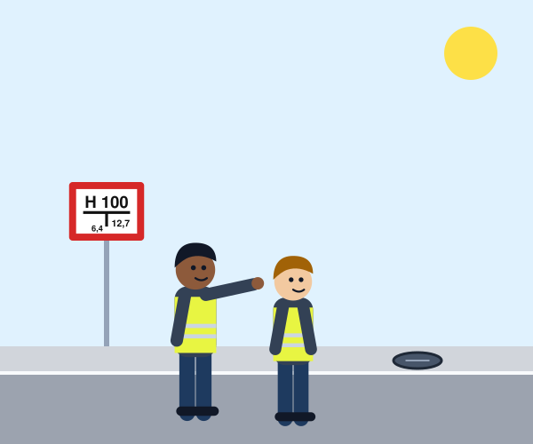
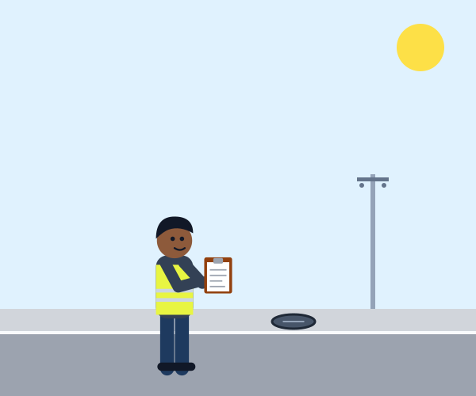
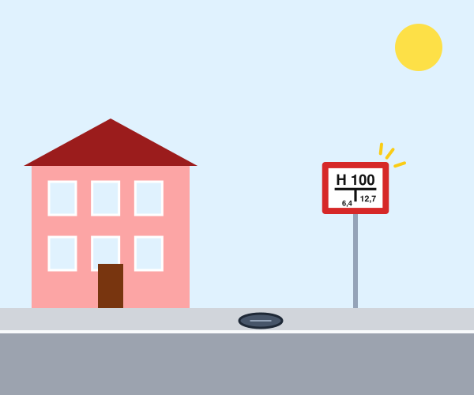

<!-- Erzeugt von handouts/feuerwehr-comic/comic.mjs. Nicht von Hand ändern, sondern dort das Skript anpassen. -->

<figure class="panel wide">
Nachts, 2:14 Uhr. Zimmerbrand in der Lindenstraße.

Gruppenführer: Wasser! Wo ist der nächste Hydrant?
</figure>
<figure class="panel">
Maschinist: Hier muss doch irgendwo einer sein …
</figure>
<figure class="panel">
Maschinist: Kein Schild – und der Deckel ist unter dem Auto!
</figure>
<figure class="panel">
Das Wasser kommt vom Überflurhydranten zwei Straßen weiter. Das kostet Minuten. Diesmal geht es gut.
</figure>
<figure class="panel">
Eine Woche später, Jugendfeuerwehr.

Jugendwartin: Wer findet die Hydranten im Ort, bevor sie jemand im Einsatz sucht?

Jugendlicher: Mit dem Handy? Ich bin dabei!
</figure>
<figure class="panel">
Der Rundgang.

Jugendliche: 12,7 Meter nach rechts, 6,4 nach vorn …

Jugendlicher: Da ist der Deckel!
</figure>
<figure class="panel">
Jugendlicher: Unterflur, Gehweg … hochgeladen!

Betreuer: Und ich achte auf die Autos.
</figure>
<figure class="panel">
Jugendliche: Schild fehlt: Das kommt auf die Mängelliste, nicht in die Karte.
</figure>
<figure class="panel">
Ein paar Wochen später: Die Gemeinde hat ein neues Schild aufgehängt.
</figure>
<figure class="panel wide">
Beim nächsten Einsatz.

Maschinist: Lindenstraße, gegenüber Nummer 12. Steht ja im Plan!
</figure>

Jeder Hydrant zählt. So macht eure Feuerwehr mit: openfiremap.org/help/fire-brigades/

## Der Comic zum Vorlesen

Bildbeschreibung und Text aller Bilder in der Lesereihenfolge.

1. **Bild:** Nacht in einer Wohnstraße. In einem Fenster im ersten Stock brennt es, Rauch steigt auf. Ein Löschfahrzeug steht auf der Straße, davor zwei Einsatzkräfte. Der Gruppenführer zeigt die Straße entlang. 
   **Text:** Nachts, 2:14 Uhr. Zimmerbrand in der Lindenstraße. 
   **Gruppenführer:** „Wasser! Wo ist der nächste Hydrant?“
2. **Bild:** Es schneit. Der Maschinist leuchtet mit der Taschenlampe den Gehweg neben einem geparkten Auto ab. 
   **Maschinist:** „Hier muss doch irgendwo einer sein …“
3. **Bild:** Der Maschinist kniet am Bordstein. Am Mast daneben fehlt das Hinweisschild, nur die leere Halterung ist zu sehen. Unter dem geparkten Auto schaut ein Hydrantendeckel hervor. 
   **Maschinist:** „Kein Schild – und der Deckel ist unter dem Auto!“
4. **Bild:** Zwei Einsatzkräfte laufen mit einem Schlauch von einem roten Überflurhydranten am Ende der Straße Richtung Einsatzstelle. Der Schlauch zieht sich lang über den Gehweg. 
   **Text:** Das Wasser kommt vom Überflurhydranten zwei Straßen weiter. Das kostet Minuten. Diesmal geht es gut.
5. **Bild:** Eine Woche später im Gerätehaus. An der Wand hängt ein Ortsplan. Die Jugendwartin steht davor, drei Jugendliche hören zu, einer meldet sich. 
   **Text:** Eine Woche später, Jugendfeuerwehr. 
   **Jugendwartin:** „Wer findet die Hydranten im Ort, bevor sie jemand im Einsatz sucht?“ 
   **Jugendlicher:** „Mit dem Handy? Ich bin dabei!“
6. **Bild:** Tag, Wohnstraße. Zwei Jugendliche in Warnwesten stehen vor einem Mast mit Hydrantenschild H 100, darunter die Zahlen 12,7 und 6,4. Eine zeigt nach rechts, auf dem Gehweg liegt ein Hydrantendeckel. 
   **Text:** Der Rundgang. 
   **Jugendliche:** „12,7 Meter nach rechts, 6,4 nach vorn …“ 
   **Jugendlicher:** „Da ist der Deckel!“
7. **Bild:** Ein Jugendlicher steht etwa drei Meter vor dem Hydrantendeckel und richtet das Handy darauf. Daneben steht ein Betreuer in Warnweste und schaut auf die Straße, auf der ein Auto vorbeifährt. 
   **Jugendlicher:** „Unterflur, Gehweg … hochgeladen!“ 
   **Betreuer:** „Und ich achte auf die Autos.“
8. **Bild:** Zurück in der Lindenstraße, bei Tag. Am Mast fehlt das Schild. Eine Jugendliche schreibt auf ein Klemmbrett. 
   **Jugendliche:** „Schild fehlt: Das kommt auf die Mängelliste, nicht in die Karte.“
9. **Bild:** Ein paar Wochen später: Am Mast in der Lindenstraße hängt ein neues, glänzendes Hydrantenschild. Der Gehweg vor dem Deckel ist frei. 
   **Text:** Ein paar Wochen später: Die Gemeinde hat ein neues Schild aufgehängt.
10. **Bild:** Wieder ein Einsatz bei Nacht. Das Löschfahrzeug hält in der Lindenstraße. Der Maschinist hält ein Tablet mit dem Ortsplan, auf dem der Hydrant als roter Punkt eingetragen ist. Am Mast hängt das neue Schild, der Deckel ist frei. 
   **Text:** Beim nächsten Einsatz. 
   **Maschinist:** „Lindenstraße, gegenüber Nummer 12. Steht ja im Plan!“

So geht der Rundgang: Trupp-Karte, Leitfaden und Folien stehen unter openfiremap.org/help/fire-brigades/.
