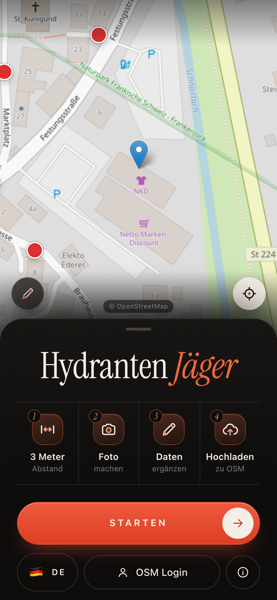
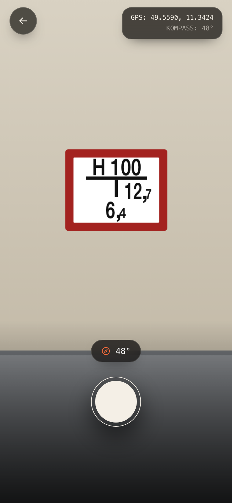
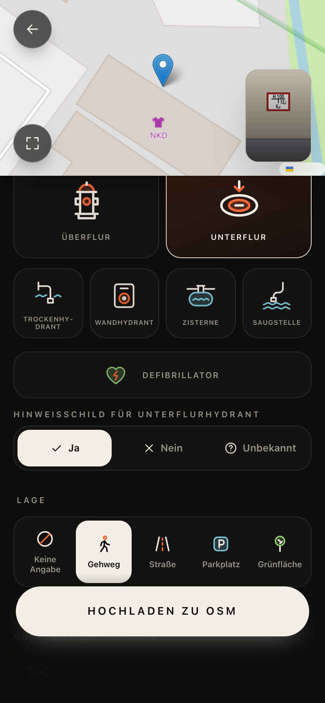

## Kurzfassung für die Wehrführung

Ein Übungsabend von 90 Minuten reicht, um die Hydranten eines Ausrückebereichs zu prüfen und fehlende in OpenStreetMap einzutragen. OpenStreetMap ist die freie Weltkarte, aus der OpenFireMap seine Hydranten, Löschwasserstellen und Defibrillatoren bezieht. Was dort fehlt, fehlt auch auf der Karte und im gedruckten Ortsplan.

<div class="cols two">

<div class="card ok">

### Was die Wehr davon hat

- Hydranten im eigenen Ausrückebereich vollständig auf der Karte und im Ortsplan
- Ortskenntnis für neue Kameradinnen und Kameraden
- Ein Projekt für die Jugendfeuerwehr mit sichtbarem Ergebnis
- Eine Mängelliste für Gemeinde oder Wasserversorger

</div>

<div class="card maybe">

### Was es kostet

- Übungsleitung: zwei bis drei Stunden Vorbereitung
- Ein Übungsabend, 90 Minuten, Trupps aus zwei bis drei Personen
- Nachbereitung: ein bis zwei Personen, eine halbe bis eine Stunde
- Kein Geld: Hydrantenjäger, OpenStreetMap und OpenFireMap sind kostenlos

</div>

</div>

<div class="cols two">

<div class="card plain">

### Worauf es ankommt

- Hydranten werden **nicht geöffnet** und nicht betätigt. Es ist eine Bestandsaufnahme, keine Prüfung nach DVGW W 400-3.
- Jede Person, die einträgt, nutzt ein **eigenes** OpenStreetMap-Konto.
- Eingetragen wird nur, was die Trupps selbst sehen. Hydrantenpläne der Gemeinde oder des Wasserversorgers dürfen nicht abgeschrieben werden.
- Warnweste, Verkehr beachten, Jugendliche nur mit Betreuung.

</div>

<div class="card">

### Was die Wehrführung entscheidet

- Rundgang als Übungsdienst ansetzen (Versicherungsschutz wie bei anderen Übungen, am besten vorab klären)
- Gemeinde oder Wasserversorger vorab informieren
- Wer die Übungsleitung übernimmt
- Ob die Jugendfeuerwehr mitmacht

</div>

</div>

> **OpenFireMap ist ein freies Projekt und ersetzt keine Einsatzunterlagen.** Im Notfall gilt immer: 112. Wie schnell neue Einträge auf der Karte erscheinen, hängt von mehreren Diensten ab. Eine feste Zeit gibt es nicht.

<div class="pb"></div>

## Vorbereitung

Am besten ein bis zwei Wochen vor dem Übungsabend beginnen.

### Zwei Wochen vorher

<div class="check">

- Mit der Wehrführung Termin und Gebiet absprechen, Übungsdienst ansetzen
- Gemeinde oder Wasserversorger kurz informieren: Bestandsaufnahme, keine Hydranten öffnen, Mängelliste folgt (Textvorschlag unten)
- Ortsplan des Ausrückebereichs drucken: openfiremap.org/ortsplan/
- Ist-Stand ansehen: OpenFireMap ab Zoomstufe 17 öffnen, vorhandene Hydranten grob zählen
- Gebiet in Planquadrate aufteilen und auf die Trupps verteilen
- Die Aktion im OpenStreetMap-Wiki beschreiben (Vorlage auf der nächsten Seite)

</div>

### Eine Woche vorher

<div class="check">

- Alle, die eintragen, legen ein eigenes OpenStreetMap-Konto an: openstreetmap.org/user/new
- Hydrantenjäger einmal auf dem eigenen Handy öffnen (hydrantenjaeger.de), mit dem Konto anmelden, Standort, Kompass und Kamera erlauben
- Trupps einteilen: je eine Person mit Handy, eine für Verkehr und Notizen
- Für jeden Trupp drucken: Trupp-Karte (beidseitig), Erfassungsbogen, Mängelliste, Ausschnitt des Ortsplans
- Optional: Prüfliste je Planquadrat als CSV-Export aus OpenFireMap

</div>

### Am Übungsabend

<div class="check">

- Handys geladen, Powerbanks dabei
- Warnwesten, Taschenlampen, Klemmbretter, Stifte
- Trupp-Karten, Bögen und Ortsplan-Ausschnitte je Trupp
- Treffpunkt und Rückkehrzeit festgelegt, Telefonnummer der Übungsleitung auf jeder Trupp-Karte

</div>

### Gebiet aufteilen

Der gedruckte Ortsplan hat ein Raster aus Planquadraten. Jeder Trupp bekommt zusammenhängende Planquadrate, zum Beispiel „Trupp 1: A1 bis C4“. Als grober Richtwert schafft ein Trupp in einer Stunde 15 bis 25 Hydranten, im Neubaugebiet mehr, im Altort mit Suchen weniger. Lieber kleinere Gebiete vergeben: Ein Trupp, der früher fertig ist, hilft beim Nachbarn.

### Gemeinde oder Wasserversorger informieren

Ein kurzer Hinweis vorab verhindert Rückfragen, wenn Feuerwehrleute in Warnwesten Hydranten suchen. Textvorschlag:

> Die Feuerwehr [Ort] macht am [Datum] im Rahmen eines Übungsdienstes eine Bestandsaufnahme der Hydranten im Ausrückebereich. Dabei werden keine Hydranten geöffnet oder betätigt. Auffällige Mängel wie fehlende Schilder oder zugeparkte Deckel notieren die Trupps. Die Liste schickt die Feuerwehr gern im Anschluss zu.

<div class="pb"></div>

## Die Aktion im OpenStreetMap-Wiki beschreiben

Wenn mehrere Personen gemeinsam und organisiert kartieren, bittet OpenStreetMap um eine kurze, öffentliche Beschreibung im OSM-Wiki (Richtlinie der OpenStreetMap Foundation für organisiertes Bearbeiten, „Organised Editing Guidelines“). So können andere Mitwirkende einordnen, warum in einem Ort plötzlich viele Hydranten neu eingetragen werden, und die Übungsleitung ansprechen.

Für ein Wiki-Konto genügt das eigene OpenStreetMap-Konto: auf wiki.openstreetmap.org mit „Anmelden“ einloggen. Dann eine neue Seite anlegen, zum Beispiel mit dem Namen „Feuerwehr Musterstadt/Hydranten-Rundgang 2027“, und diese Vorlage ausfüllen:

```
== Hydranten-Rundgang der Feuerwehr Musterstadt ==

; Wer: Freiwillige Feuerwehr Musterstadt
; Ansprechperson: Vorname Nachname (OSM-Benutzername: …), E-Mail: …
; Wann: Übungsabend am TT.MM.JJJJ, Nachbereitung bis TT.MM.JJJJ
; Gebiet: Ausrückebereich der Feuerwehr Musterstadt (Gemeinde Musterstadt, Ortsteile …)

=== Ziel ===
Hydranten, Löschwasserstellen und öffentlich zugängliche Defibrillatoren
im Ausrückebereich vor Ort prüfen, fehlende eintragen und falsche korrigieren.

=== Vorgehen ===
* Trupps aus 2–3 Personen gehen das Gebiet ab, jede Person mit eigenem OSM-Konto.
* Eingetragen wird nur, was vor Ort zu sehen ist (Hinweisschild, Hydrant).
  Pläne der Gemeinde oder des Wasserversorgers werden nicht übernommen.
* Werkzeuge: Hydrantenjäger (Handy), iD-Editor (Nachbereitung).
* Merkmale: emergency=fire_hydrant mit fire_hydrant:type, fire_hydrant:diameter;
  emergency=suction_point, emergency=water_tank, emergency=defibrillator.
* Änderungen im iD-Editor tragen den Hashtag #OpenFireMap.

=== Mitwirkende Konten ===
* Benutzername 1
* Benutzername 2

=== Rückfragen ===
Bitte an die Ansprechperson oben oder über die OSM-Nachrichtenfunktion.
```

Die Seite danach auf der Übersicht der organisierten Aktivitäten im Wiki verlinken (Suche im Wiki nach „Organised Editing/Activities“). Benutzernamen nur mit Einverständnis der Personen aufführen.

### Hashtag und Änderungskommentar

Jede Änderung in OpenStreetMap trägt einen kurzen Kommentar. **Hydrantenjäger setzt diesen Kommentar selbst** („… via Hydranten Jäger“), dort ist nichts einzugeben. Wer in der Nachbereitung mit dem iD-Editor arbeitet, schreibt `#OpenFireMap` in den Kommentar. Alle Änderungen des Abends findet ihr außerdem über die Benutzernamen auf der Wiki-Seite.

<div class="pb"></div>

## Hydrantenjäger in drei Bildern

Hydrantenjäger ist eine Web-App für das Handy. Sie läuft im Browser, nichts muss installiert werden. Die ausführliche Hilfe steht unter hydrantenjaeger.de/help/.

<div class="cols three shots">

<div>



</div>

<div>



</div>

<div>



</div>

</div>

<div class="cols two">

<div class="card plain">

### Neuen Hydranten eintragen

1. Einmal mit „OSM Login“ anmelden.
2. „Starten“ tippen, etwa 3 m vor den Hydranten stellen, Handy auf ihn richten, Foto auslösen. Die App setzt den Punkt 3 m vor das Handy.
3. Lage auf der Karte prüfen, Punkt bei Bedarf verschieben.
4. Typ und Lage wählen, Nennweite und Nummer nur, wenn sie sicher sind (Schild).
5. „Hochladen zu OSM“.

</div>

<div class="card plain">

### Vorhandenen Hydranten prüfen

1. Auf der Karte den roten Punkt antippen.
2. Typ, Lage, Nennweite und Nummer mit dem vergleichen, was vor Ort zu sehen ist.
3. Falsches ändern, Punkt verschieben, wenn er mehr als ein paar Meter daneben liegt.
4. Mit „OSM Aktualisieren“ speichern.
5. Nur löschen, wenn der Hydrant sicher nicht mehr existiert.

</div>

</div>

**Gut zu wissen:** Das Foto bleibt auf dem Handy und wird nicht hochgeladen. Ist der Standort zu ungenau, lässt die App nicht eintragen: ein paar Schritte ins Freie gehen und kurz warten. Autos, Laternen und Metallzäune stören den Kompass. Ohne Netz den Hydranten auf dem Erfassungsbogen notieren.

<div class="pb"></div>

## Ablauf des Übungsabends

| Zeit | Was passiert | Wer |
|---|---|---|
| 0–15 min | Einweisung (Stichpunkte unten), Trupp-Karten und Bögen ausgeben | Übungsleitung |
| 15–75 min | Trupps gehen ihre Planquadrate ab: finden, prüfen, eintragen oder korrigieren, Mängel notieren | Trupps |
| 75–90 min | Rückkehr, kurze Auswertung, Bögen und Mängellisten einsammeln | alle |

### Einweisung in 15 Minuten

1. **Warum:** Wer im Einsatz Wasser sucht, verliert Zeit. Die Karte zeigt nur, was eingetragen ist.
2. **Sicherheit:** Warnweste, nicht auf der Fahrbahn stehen bleiben, eine Person achtet auf den Verkehr. Hydranten nicht öffnen, Deckel nicht anheben. Private Grundstücke nur mit Erlaubnis.
3. **Hinweisschild lesen:** H für Hydrant, die Zahl daneben ist die Nennweite (DN). Die Zahlen an den Linien geben an, wie viele Meter der Hydrant seitlich und nach vorn vom Schild entfernt liegt (Rückseite der Trupp-Karte).
4. **Typen:** Unterflur, Überflur, Wandhydrant, Saugstelle, Zisterne, Defibrillator (Trupp-Karte).
5. **Hydrantenjäger vorführen:** einmal am Hydranten vor dem Gerätehaus, mit allen Schritten bis „Hochladen“.
6. **Mängel getrennt:** fehlende Schilder, zugeparkte oder zugewachsene Hydranten kommen auf die Mängelliste, **nicht** in OpenStreetMap.
7. **Organisatorisches:** Gebiete, Rückkehrzeit, Telefonnummer der Übungsleitung.

### Rollen im Trupp

<div class="cols three">

<div class="card">

### Handy

Bedient Hydrantenjäger, trägt ein und korrigiert.

</div>

<div class="card">

### Sicherung

Achtet auf den Verkehr, sucht mit der Taschenlampe, liest das Schild.

</div>

<div class="card">

### Notizen

Führt Erfassungsbogen und Mängelliste. Bei zwei Personen übernimmt das die Sicherung.

</div>

</div>

### Was vor Ort schiefgehen kann

| Problem | Was tun |
|---|---|
| Kein Netz | Hydranten auf dem Erfassungsbogen notieren (Straße, Hausnummer gegenüber, Typ, Schild), in der Nachbereitung eintragen |
| Standort ungenau | Ein paar Schritte ins Freie, weg von hohen Häusern, kurz warten |
| Punkt landet daneben | Vor dem Hochladen auf der Karte verschieben; Abstand zu Autos und Metall halten |
| Hydrant nicht zu finden | Im Umkreis des Schilds suchen, auch auf der anderen Straßenseite. Nicht gefunden: auf die Mängelliste, nichts löschen |
| Schild ohne Hydrant oder Hydrant ohne Schild | Hydrant eintragen, wenn er zu sehen ist, das fehlende Schild auf die Mängelliste |
| Handy-Akku leer | Powerbank, sonst auf Papier weiter |

## Sicherheit und Regeln

> **Für jeden Trupp:** Warnweste tragen und nicht auf der Fahrbahn stehen bleiben. Kinder und Jugendliche nur mit Betreuung. Hydranten nicht öffnen, nicht betätigen, Deckel nicht anheben: Die Prüfung ist Sache des Wasserversorgers. Private Grundstücke nur mit Erlaubnis betreten, Wandhydranten in Gebäuden nur mit Zustimmung.

- **Fotos ohne Personen und Kennzeichen.** Hydrantenjäger lädt Fotos nicht hoch, sie bleiben auf dem Handy. Wer Fotos speichert oder weitergibt: Sie enthalten den Standort.
- **Nur eintragen, was ihr selbst seht.** Hydrantenpläne der Gemeinde oder des Wasserversorgers sind urheberrechtlich geschützt und passen nicht zur Lizenz von OpenStreetMap.
- **Eigene Konten.** Keine gemeinsamen Konten für die ganze Wehr: OpenStreetMap möchte nachvollziehen können, wer was geändert hat.
- **Jugendfeuerwehr.** Für Kinder und Jugendliche gelten die Regeln von OpenStreetMap und das Einverständnis der Eltern. Einfacher ist oft: Die Jugendlichen suchen, prüfen und notieren, eine Betreuerin oder ein Betreuer trägt mit dem eigenen Konto ein.
- **Versicherung.** Den Versicherungsschutz klärt die Wehrführung am besten vorab, wie bei jedem anderen Übungsdienst. Dieser Leitfaden ist keine Rechtsberatung.

<div class="pb"></div>

## Nachbereitung

Ein bis zwei Personen am Computer, eine halbe bis eine Stunde.

<div class="check">

- **Angekommen?** In OpenFireMap nachsehen, ob die Einträge des Abends da sind. Neue Einträge erscheinen nicht immer sofort, eine feste Zeit gibt es nicht. In OpenStreetMap selbst sind sie direkt nach dem Hochladen gespeichert.
- **Papier nachtragen.** Notizen vom Erfassungsbogen mit dem iD-Editor eintragen (openstreetmap.org, „Bearbeiten“), Kommentar mit `#OpenFireMap`.
- **Qualitätsblick.** Doppelte Punkte, Hydranten ohne Typ, Punkte mitten auf einem Dach. Eigene Änderungen findet ihr über das Profil auf openstreetmap.org.
- **Mängelliste abschicken.** Abtippen und mit dem Anschreiben aus den Bögen an Gemeinde oder Wasserversorger schicken.
- **Ortsplan neu drucken** und im Gerätehaus aushängen, gern auch für die Fahrzeugmappen.
- **Wiki-Seite ergänzen.** Kurz eintragen, was erledigt ist (zum Beispiel Anzahl neu und korrigiert).

</div>

### Danach

Hydranten kommen dazu, werden versetzt oder verschwinden. Empfehlenswert ist ein Rundgang im Jahr, etwa im Frühjahr nach dem Winterdienst, dazu Neubaugebiete, sobald die Straßen fertig sind.

Dieser Leitfaden ist ein erster Stand vor dem Praxistest mit einer Feuerwehr. Wie ist euer Rundgang gelaufen, was fehlt oder ist unklar? Rückmeldungen gern an info@openfiremap.org.
