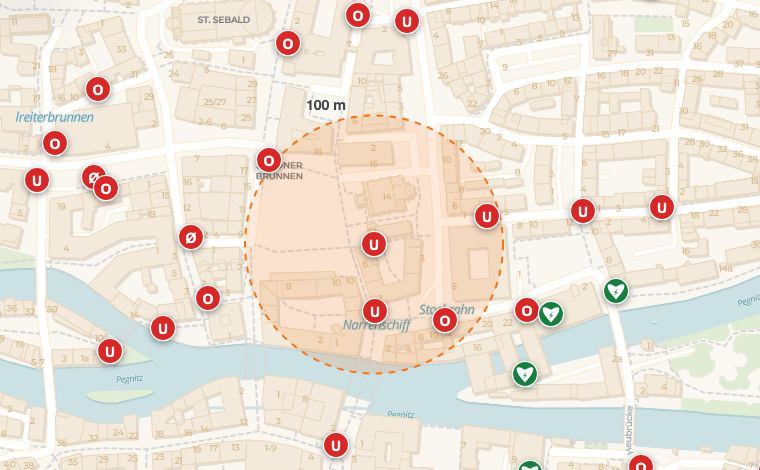
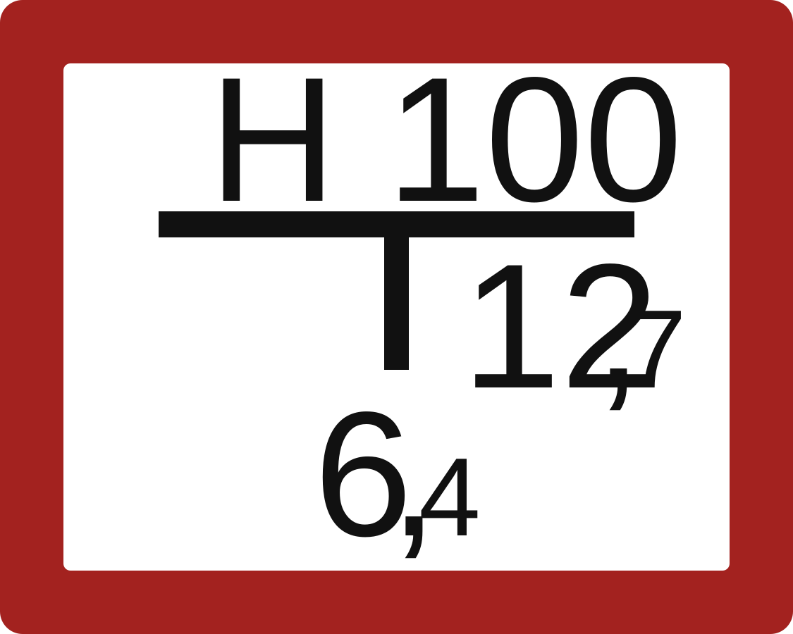
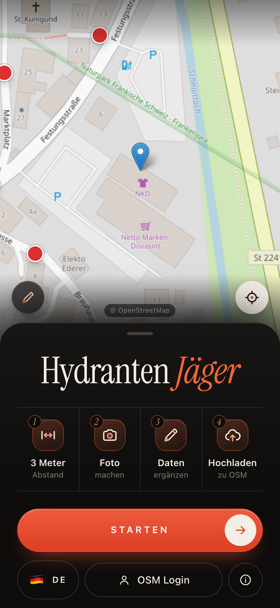
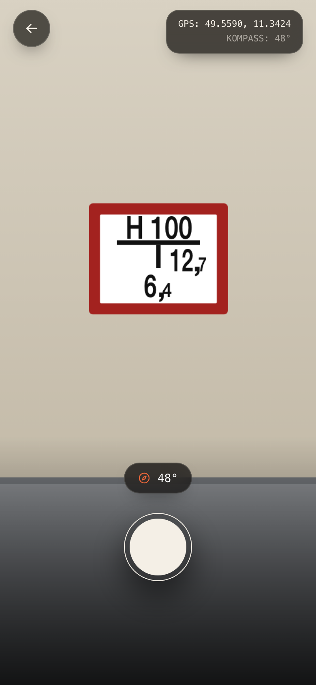
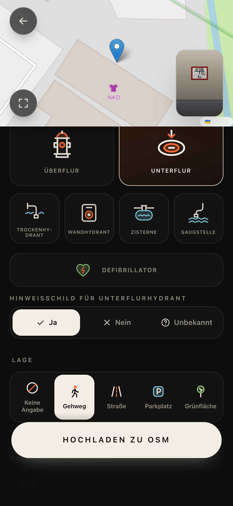
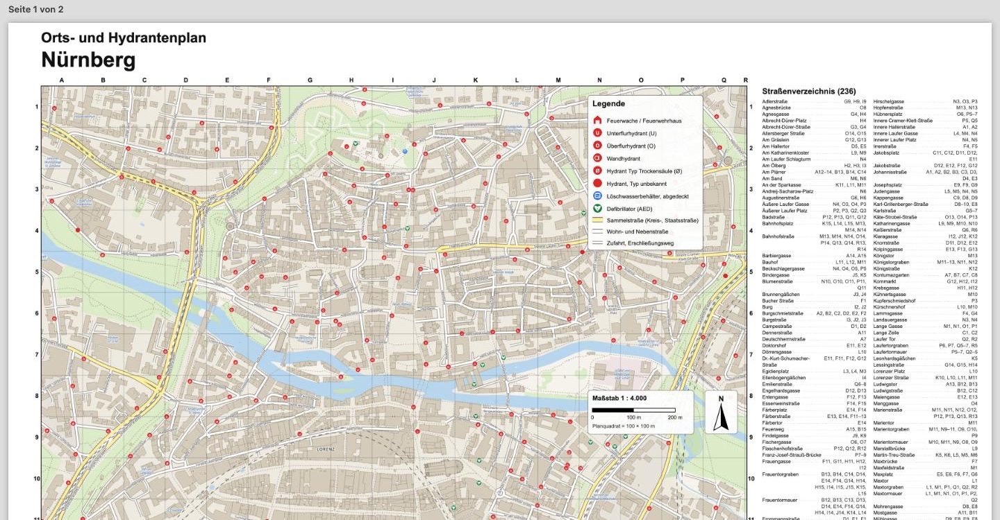

Feuerwehr
Datum
Übungsleitung

Diese Folien begleiten die Einweisung zu Beginn des Übungsabends, etwa 15 Minuten. Alles Weitere steht im Leitfaden für die Übungsleitung.

## Warum heute Abend?

**Wer im Einsatz Wasser sucht, verliert Zeit.**

OpenFireMap zeigt die Hydranten, Löschwasserstellen und Defibrillatoren aus OpenStreetMap, der freien Weltkarte. Fehlt dort ein Hydrant, fehlt er auch auf der Karte und im gedruckten Ortsplan.

Heute geht ihr euer Gebiet ab und sorgt dafür, dass die Karte stimmt.

### Was dabei herauskommt

- Alle Hydranten eures Gebiets auf der Karte
- Ortskenntnis: Wer einen Hydranten selbst gesucht hat, findet ihn wieder
- Eine Mängelliste für Gemeinde oder Wasserversorger
- Ein aktueller Ortsplan für Gerätehaus und Fahrzeuge

## So sieht es auf der Karte aus

- **openfiremap.org** im Browser, auf Handy und PC
- Die Daten kommen aus **OpenStreetMap**. Jede und jeder kann dort mit einem kostenlosen Konto eintragen.
- Daraus druckt ihr später den **Ortsplan** mit Planquadraten und Straßenverzeichnis.
- Kein Ersatz für amtliche Einsatzunterlagen. Im Notfall: **112**.

## Was ist was?

### Unterflurhydrant

Deckel im Boden, meist auf Gehweg oder Fahrbahn. Ohne Schild kaum zu finden.

### Überflurhydrant

Säule über dem Boden, oft rot.

### Wandhydrant

Anschluss in einer Wand oder einem Schrank, oft in Gebäuden.

### Saugstelle

Stelle zum Ansaugen an Bach, Teich oder Brunnen.

### Zisterne und Löschteich

Löschwasserbehälter unter der Erde oder offener Teich.

### Defibrillator

Öffentlich zugänglich? Wo genau, wann erreichbar?

## Hinweisschild lesen

- **H** = Hydrant, **100** = Nennweite DN 100 der Leitung
- **Zahl neben dem senkrechten Strich:** so viele Meter seitlich vom Schild, zu der Seite, auf der die Zahl steht
- **Zahl unter dem senkrechten Strich:** so viele Meter vor dem Schild
- Nicht da? Im Umkreis suchen. Manche Schilder stehen auf der anderen Straßenseite.
- Blauer, gelber oder grüner Rand: Schieber, Gas oder andere Leitungen, nicht erfassen

## Hydrantenjäger: die App für heute Abend

## Sechs Schritte am Hydranten

1. **Finden.** Schild suchen und lesen. Mit der Taschenlampe absuchen, nicht mit der Hand unter Autos greifen.
2. **Nachsehen.** Steht in Hydrantenjäger schon ein Punkt in der Nähe?
3. **Neu eintragen.** Etwa 3 m davor stellen, Handy auf ihn richten, Typ und Lage wählen.
4. **Vorhandenen prüfen.** Marker antippen: Typ, Nennweite, Nummer richtig? Liegt er daneben, verschieben, dann „OSM Aktualisieren“.
5. **Hochladen.** Kein Netz? Auf dem Erfassungsbogen notieren, später nachtragen.
6. **Mängel getrennt notieren.** Auf die Mängelliste, **nicht** in OpenStreetMap.

## Mängel gehören auf die Liste, nicht in die Karte

### Auf die Mängelliste

- Schild fehlt, ist unleserlich oder zeigt falsche Werte
- Deckel zugeparkt, überteert, zugeschüttet oder zugewachsen
- Hydrant beschädigt, schief oder nicht erreichbar

Dazu: Straße, Hausnummer gegenüber, Foto ja oder nein.

### In OpenStreetMap

- Was ihr selbst seht: Lage, Typ, Nennweite und Nummer vom Schild
- Keine Hydrantenpläne der Gemeinde oder des Wasserversorgers abschreiben, sie sind urheberrechtlich geschützt
- Jede Person trägt mit dem **eigenen** Konto ein

## Sicherheit

> **Warnweste tragen, nicht auf der Fahrbahn stehen bleiben.** Eine Person bedient das Handy, eine achtet auf den Verkehr.
>
> **Hydranten nicht öffnen, nicht betätigen, Deckel nicht anheben.** Das ist Sache des Wasserversorgers.
>
> **Private Grundstücke nur mit Erlaubnis**, Wandhydranten in Gebäuden nur mit Zustimmung.
>
> **Fotos ohne Personen und Kennzeichen.** Kinder und Jugendliche nur mit Betreuung.

## Ablauf heute Abend

| Zeit | Was passiert |
|---|---|
| 0–15 min | Einweisung, Trupp-Karten und Bögen ausgeben |
| 15–75 min | Planquadrate abgehen: finden, prüfen, eintragen oder korrigieren, Mängel notieren |
| 75–90 min | Zurück am Gerätehaus: kurze Auswertung, Bögen und Mängellisten abgeben |

### Handy

Bedient Hydrantenjäger, trägt ein und korrigiert.

### Sicherung

Achtet auf den Verkehr, sucht mit der Taschenlampe, liest das Schild.

### Notizen

Führt Erfassungsbogen und Mängelliste.

## Und danach?

- **Neue Einträge** erscheinen in OpenFireMap nicht immer sofort. Wie lange es dauert, hängt von den Diensten ab, über die die Karte lädt.
- **Papiernotizen** trägt die Nachbereitung am Computer nach.
- **Die Mängelliste** geht an Gemeinde oder Wasserversorger.
- **Der neue Ortsplan** hängt danach im Gerätehaus.

## Fragen? Dann los.

### Für unterwegs

- Trupp-Karte: sechs Schritte, Sicherheit, Schild, Typen
- Erfassungsbogen und Mängelliste
- Telefonnummer der Übungsleitung
- Rückkehr ans Gerätehaus um: ______

### Zum Nachlesen

- openfiremap.org/help/fire-brigades/
- hydrantenjaeger.de/help/
- Ortsplan: openfiremap.org/help/town-plan/

