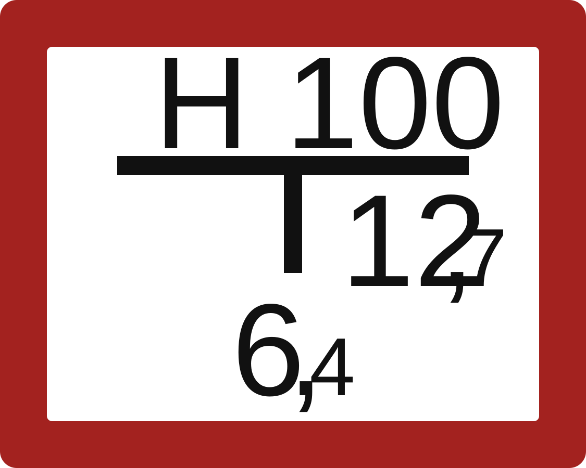

Trupp
Planquadrate
Übungsleitung / Telefon
Treffpunkt und Uhrzeit zurück

## Sechs Schritte am Hydranten

1. **Finden.** Hinweisschild suchen und lesen (Rückseite). Hydranten mit der Taschenlampe absuchen, nicht mit der Hand unter Autos greifen.
2. **Nachsehen.** In Hydrantenjäger oder OpenFireMap: Steht schon ein Punkt in der Nähe?
3. **Neu eintragen.** Etwa 3 m vor den Hydranten stellen, Handy auf ihn richten, Typ und Lage wählen. Nennweite und Nummer nur, wenn sie sicher sind (Schild).
4. **Vorhandenen prüfen.** Typ, Nennweite, Nummer richtig? Mehr als ein paar Meter daneben: Punkt verschieben.
5. **Hochladen.** Kein Netz? Auf dem Erfassungsbogen notieren, später nachtragen.
6. **Mängel getrennt notieren.** Schild fehlt, Deckel zugeparkt oder überteert, zugewachsen, beschädigt: auf die Mängelliste, **nicht** in OpenStreetMap.

Im Änderungskommentar immer den Hashtag `#OpenFireMap` angeben.

## Sicherheit

> **Warnweste tragen, nicht auf der Fahrbahn stehen bleiben.** Eine Person bedient das Handy, eine achtet auf den Verkehr. Kinder und Jugendliche nur mit Betreuung.
>
> **Hydranten nicht öffnen, nicht betätigen, Deckel nicht anheben.** Private Grundstücke nur mit Erlaubnis, Wandhydranten in Gebäuden nur mit Zustimmung.
>
> **Fotos ohne Personen und Kennzeichen.** Nur eintragen, was ihr selbst seht, keine fremden Pläne abschreiben.

Im Notfall gilt immer: **112**. OpenFireMap ersetzt keine Einsatzunterlagen.

## Hinweisschild lesen

- **H** = Hydrant, **100** = Nennweite DN 100 der Leitung.
- **Zahl neben dem senkrechten Strich:** so viele Meter liegt der Hydrant seitlich vom Schild, zu der Seite, auf der die Zahl steht.
- **Zahl unter dem senkrechten Strich:** so viele Meter liegt er vor dem Schild.
- Findet ihr ihn dort nicht, im Umkreis suchen. Schilder hängen nicht immer genau, und manche stehen auf der anderen Straßenseite.
- Schilder mit blauem, gelbem oder grünem Rand gehören zu Schiebern, Gas- oder anderen Leitungen und werden nicht erfasst.

## Was ist was?

### Unterflurhydrant

Deckel im Boden, meist auf Gehweg oder Fahrbahn. Ohne Schild kaum zu finden.

`fire_hydrant:type=underground`

### Überflurhydrant

Säule über dem Boden, oft rot.

`fire_hydrant:type=pillar`

### Wandhydrant

Anschluss in einer Wand oder einem Schrank, oft in Gebäuden.

`fire_hydrant:type=wall`

### Saugstelle

Stelle zum Ansaugen an Bach, Teich oder Brunnen, manchmal mit Hinweisschild.

`emergency=suction_point`

### Zisterne und Löschteich

Löschwasserbehälter (Zisterne, unterirdischer Tank) oder offener Löschwasserteich.

`emergency=water_tank` · `emergency=fire_water_pond`

### Defibrillator

Öffentlich zugänglich? Wo genau, wann erreichbar?

`emergency=defibrillator`

Jeder Hydrant trägt zusätzlich `emergency=fire_hydrant`. Die Apps setzen die Merkmale selbst, ihr wählt nur aus.

## Auf die Mängelliste, nicht in OpenStreetMap

- Schild fehlt, ist unleserlich oder zeigt falsche Werte
- Deckel zugeparkt, überteert, zugeschüttet oder zugewachsen
- Hydrant beschädigt, schief oder nicht erreichbar

Notiert dazu den Ort so genau wie möglich (Straße, Hausnummer gegenüber) und ob ihr ein Foto habt.
