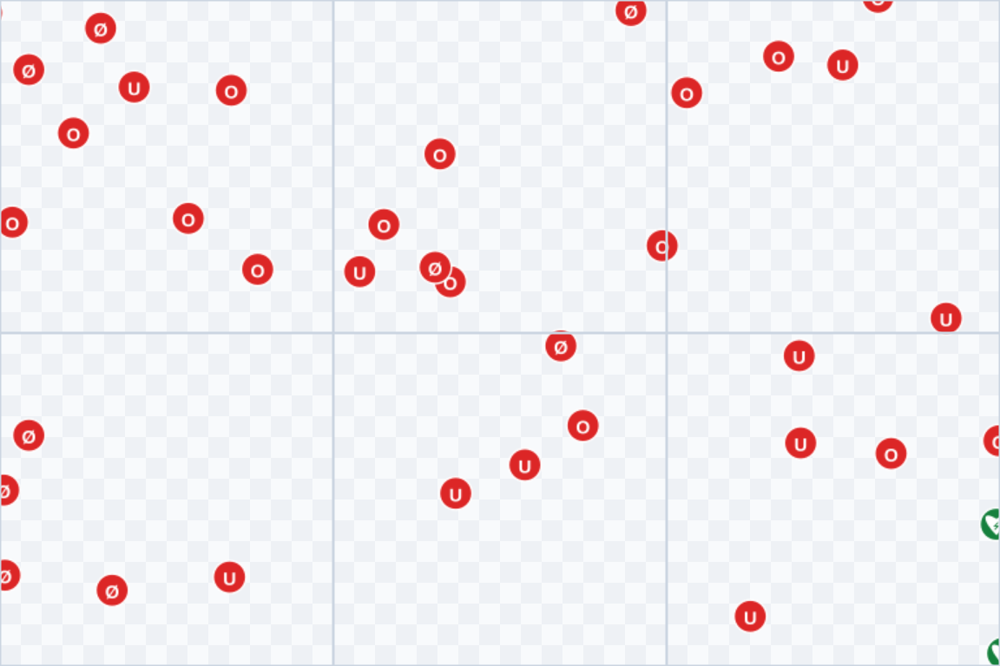
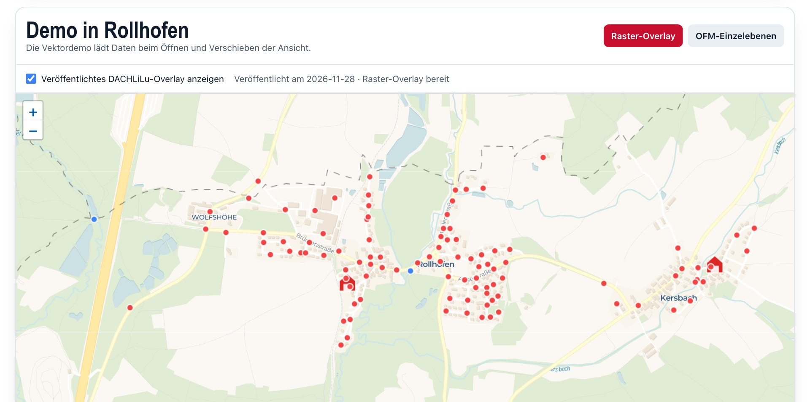
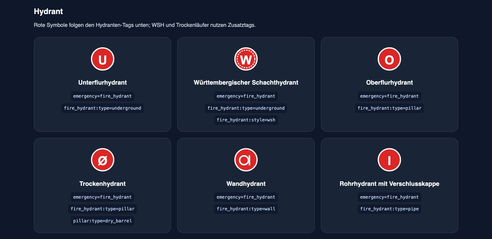

## Auf einen Blick

Dieser Leitfaden gehört zu **openfiremap.org**, meinem Projekt. OpenFireMap ist ein nichtkommerzielles Open-Source-Projekt auf Basis von OpenStreetMap. Ich betreibe es als Privatperson und teile es gern.

Früher gab es auch eine Seite unter openfiremap.de. Es geht hier ausschließlich um **openfiremap.org**.

Das **Overlay** ist eine transparente Kartenebene mit feuerwehrrelevanten Objekten: Hydranten, Löschwasserstellen, Feuerwachen und Defibrillatoren. Sie legen es über Ihre eigene Grundkarte, zum Beispiel in Einsatz- und Lagekarten.

```url
https://tiles.openfiremap.org/hytiles/{z}/{x}/{y}.png
```

Beschreibung der Ebene (TileJSON): `https://tiles.openfiremap.org/hytiles.json`

| Eigenschaft | Wert |
| --- | --- |
| Format | PNG mit Transparenz, 256 × 256 Pixel |
| Kachelschema | XYZ („Slippy Map“), Web Mercator (EPSG:3857) |
| Zoomstufen | 12 bis 18 |
| Abdeckung | Deutschland, Österreich, die Schweiz, Luxemburg und Liechtenstein (kurz DACHLiLu). Weitere Gebiete sind bei Interesse möglich (siehe „Was ich unterstütze“). |
| Aktualisierung | wöchentlich. Die URL bleibt dabei immer gleich, am Client muss nichts geändert werden. |
| Transport | ausschließlich verschlüsselt über **HTTPS** |
| Quellenangabe | © OpenStreetMap contributors (Lizenz ODbL), bitte sichtbar auf der Karte angeben |
| Zugang | derzeit offen und ohne Anmeldung (Testbetrieb). Eine Absicherung ist mittelfristig geplant. |

## Zwei Wege zum Overlay

<div class="cols two">

<div class="card legacy">

### Weg 1 – Klassische Kachel-URL

**Bewährt (Legacy) und weiterhin unterstützt.** Läuft in jedem Kartenprogramm und jeder Kartenbibliothek, ohne Zusatzsoftware. Voraussetzung ist ein Server, der jede Kachel einzeln nachschlägt und ausliefert.

Geeignet, wenn Sie schnell etwas einbinden möchten oder Ihr System nur URL-Vorlagen versteht.

</div>

<div class="card future">

### Weg 2 – PMTiles (Zielweg)

**Hier geht die Entwicklung hin.** Alle Kacheln liegen in einer einzigen Datei. Der Client liest direkt daraus, ohne Kachelserver dazwischen: schneller, günstiger und unabhängiger.

Geeignet, wenn Sie Ihre Karte selbst entwickeln oder die Daten selbst hosten möchten.

</div>

</div>

Beide Wege liefern dieselbe Kartenebene. Ein Archivwechsel erfordert bei keinem der beiden eine Änderung in Ihrer Einbindung.

### Schnellstart in drei Schritten

1. Die URL oben als **XYZ-Kachelebene** über Ihrer Grundkarte eintragen.
2. Zoomstufen **12 bis 18** und Kachelgröße **256** einstellen.
3. Die Quelle **© OpenStreetMap contributors** auf der Karte anzeigen.



## Ansehen, ausprobieren und Symbole

### Die Overlay-Seite

Unter [openfiremap.org/overlay](https://openfiremap.org/overlay/) können Sie das Overlay direkt ansehen. Die Demo (Beispiel Rollhofen) zeigt, **wie die Ebene über einer Grundkarte gerendert wird**. Sie schaltet zwischen dem veröffentlichten Raster-Overlay für DACHLiLu und den OFM-Einzelebenen um: Hydranten, Löschwasserstellen, Feuerwachen, Defibrillatoren und Verwaltungsgrenzen.

Dort können Sie außerdem einen Kartenausschnitt als PNG-ZIP laden, das PMTiles-Archiv herunterladen und die Einbindung in Leaflet und MapLibre nachlesen.



### Kartenzeichen und OSM-Tags

Unter [openfiremap.org/symbols](https://openfiremap.org/symbols/) sehen Sie **alle Symbole** mit den OpenStreetMap-Tags, aus denen sie abgeleitet werden: Hydranten nach Bauart (zum Beispiel Unterflur, Oberflur, Wandhydrant), Wasserstellen, Feuerwachen, Defibrillatoren und weitere. Die Tags sind unverändert angegeben.



> **Sie verwenden andere Symbole?** Bitte sprechen Sie mich an. Vielleicht lässt sich etwas einrichten. **Bevorzugt ist, dass Sie die Darstellung selbst umsetzen.** Dafür kann ich die PMTiles-Datei mit den Vektordaten bereitstellen; Gebiet und Umfang besprechen wir gemeinsam. Aus den OSM-Tags der Symbolseite zeichnen Sie dann Ihr eigenes Symbolset. Das Raster-Overlay mit den fertigen Symbolen gibt es vorerst nur für Deutschland, Österreich, die Schweiz, Luxemburg und Liechtenstein.

## Weg 1: Klassische Kachel-URL

Tragen Sie die URL-Vorlage als XYZ-Kachelebene über Ihrer Grundkarte ein. Wer bisher einen Endpunkt auf **openfiremap.de** mit demselben Pfad `/hytiles/{z}/{x}/{y}.png` eingebunden hatte, ersetzt nur den Host durch `tiles.openfiremap.org`.

### Leaflet

```js
L.tileLayer('https://tiles.openfiremap.org/hytiles/{z}/{x}/{y}.png', {
  minZoom: 12, maxNativeZoom: 18, maxZoom: 19,
  attribution: '© OpenStreetMap contributors'
}).addTo(map);
```

### OpenLayers

```js
new ol.layer.Tile({ source: new ol.source.XYZ({
  url: 'https://tiles.openfiremap.org/hytiles/{z}/{x}/{y}.png',
  minZoom: 12, maxZoom: 18, attributions: '© OpenStreetMap contributors' }) });
```

### QGIS und andere Programme

In QGIS: *Layer → Datenquellenverwaltung → XYZ → Neu*, URL eintragen, minimale Zoomstufe 12, maximale 18. Jede Software mit XYZ- oder TMS-Unterstützung kann die URL-Vorlage verwenden.

### Eine einzelne Kachel selbst berechnen

Wer eine bestimmte Kachel abrufen möchte, rechnet Breite und Länge in die Kachelnummern `x` und `y` um (Standard der „Slippy Map“-Kacheln):

```js
function kachelUrl(lat, lon, z) {
  const n = 2 ** z;
  const x = Math.floor((lon + 180) / 360 * n);
  const y = Math.floor((1 - Math.asinh(Math.tan(lat * Math.PI / 180)) / Math.PI) / 2 * n);
  return `https://tiles.openfiremap.org/hytiles/${z}/${x}/${y}.png`;
}
// kachelUrl(49.4521, 11.0767, 16) → .../hytiles/16/34784/22380.png (Nürnberg)
```

### Verhalten des Dienstes

| Fall | Antwort |
| --- | --- |
| Kachel mit Daten | Status 200, `image/png`, 256 × 256 Pixel. |
| Gebiet ohne Daten | Status 200 mit einem leeren, transparenten PNG, auch außerhalb der Zoomstufen 12–18. Es ist kein Fehler, die Kachel bleibt unsichtbar. |
| Wiederholte Abrufe | `ETag` und `Cache-Control` (Browser etwa 5 Minuten). Bedingte Abrufe mit `If-None-Match` antworten mit 304. |
| Methoden und Pfade | `GET` und `HEAD`. Andere Methoden liefern 405, unbekannte Pfade 404. |
| Störung | Status 503 mit `Retry-After`. Bitte nicht in einer engen Schleife wiederholen. |

### Hinweise für die Praxis

- **Nur HTTPS.** Bitte ausschließlich die verschlüsselte Adresse verwenden.
- **Browserzugriff per Skript** (`fetch`, Export über Canvas) braucht eine Freigabe Ihrer Website-Herkunft (CORS). Normale Kachelbilder in Kartenbibliotheken benötigen sie nicht. Bitte vorab melden.
- **Große Druckaufträge:** Abrufe mäßig parallelisieren und Kacheln zwischenspeichern. Bei sehr großen Aufträgen bitte vorher melden.
- **Zugangsschutz und Mengenbegrenzung** sind mittelfristig geplant, damit nur berechtigte Systeme zugreifen und der Dienst für alle stabil bleibt. Je nach Ihrem Aufbau ist das über feste Server-IP-Adressen, einen Schlüssel in der URL oder einen eigenen Header möglich. Dazu spreche ich vorab mit Ihnen.
- **Verfügbarkeit:** Ich betreibe den Dienst als Privatperson in meiner Freizeit, derzeit als Testbetrieb und ohne Verfügbarkeitszusage. Für kritische Anwendungen empfehle ich das eigene Hosting nach Weg 2. Brauchen Sie bestimmte Verfügbarkeiten, sprechen wir bitte telefonisch über die Möglichkeiten.

### Schnelltest und Fehlersuche

Ob der Dienst antwortet, zeigt ein einzelner Abruf (Kachel in Nürnberg). Erwartet werden `HTTP/2 200` und `content-type: image/png`.

```sh
curl -I https://tiles.openfiremap.org/hytiles/16/34784/22380.png
```

- **Die Kachel bleibt leer:** Zoomstufe 12–18 und Gebiet (DACHLiLu) prüfen. Leere Kacheln sind kein Fehler.
- **404:** Der Pfad muss genau `/hytiles/{z}/{x}/{y}.png` lauten, einschließlich der Endung `.png`.
- **CORS-Fehler oder „Failed to fetch“:** betrifft nur Skriptzugriffe im Browser. Bitte die Website-Herkunft melden, damit sie freigeschaltet wird.

## Weg 2: PMTiles – der Weg nach vorn

Klassische Kachel-URLs haben eine lange Tradition und funktionieren überall. Sie sind aber nicht mehr der effizienteste Weg. Ich unterstütze sie weiterhin gern, entwickle OpenFireMap aber auf **PMTiles** hin.

### Was ist PMTiles?

PMTiles ist ein offenes Format (Protomaps): **eine einzige Datei** enthält alle Kacheln und ein Inhaltsverzeichnis. Ein Client holt sich per HTTP-Bereichsabruf (*Range Request*) genau die Bytes, die er für den sichtbaren Kartenausschnitt braucht, direkt aus der Datei. Die Datei liegt als normale statische Datei auf einem Webserver oder CDN. Einen Kachelserver gibt es nicht mehr.

### Warum PMTiles?

- **Kein Server dazwischen:** weniger bewegliche Teile, weniger Rechenzeit, die Last verteilt sich über ein CDN von selbst.
- **Unabhängigkeit:** Sie können die Datei selbst hosten und sind nicht von meinem Server abhängig. Gerade für Einsatzkarten wichtig.
- **Offener Standard:** freie Bibliotheken für Leaflet, MapLibre, OpenLayers und weitere. Kein Hersteller ist festgelegt.
- **Mehr Gestaltung:** Als Vektorarchiv zeichnet der Client die Karte selbst. Symbole, Farben und etwa der Hydrantendurchmesser lassen sich anpassen, ohne dass das Archiv neu gebaut werden muss. Die Darstellung bleibt bei jeder Vergrößerung scharf, auch im Kartendruck. Die Hauptkarte auf openfiremap.org arbeitet bereits so. Für eigene Symbole kann ich die Vektordaten als PMTiles bereitstellen (siehe „Ansehen, ausprobieren und Symbole“).

### Das Overlay als PMTiles-Archiv

| Eigenschaft | Wert |
| --- | --- |
| Inhalt | Raster-PMTiles mit transparenten PNG-Kacheln, Deutschland, Österreich, Schweiz, Luxemburg und Liechtenstein, Zoomstufen 12 bis 18, rund 5,3 GB (Stand 28. November 2026) |
| Aktueller Verweis | Das Manifest `https://raster-pilot.openfiremap.org/manifest.json` zeigt immer auf das aktuelle Archiv. Der Dateiname ist versionsgebunden: **nie fest eintragen**, immer zuerst das Manifest lesen. |
| Download | Das Archiv lässt sich auf [openfiremap.org/overlay](https://openfiremap.org/overlay/) herunterladen. Dort gibt es auch eine Demo und einen Ausschnitts-Download. |

### Leaflet (Raster-PMTiles)

```js
import { PMTiles, leafletRasterLayer } from 'pmtiles';
const manifestUrl = 'https://raster-pilot.openfiremap.org/manifest.json';
const manifest = await fetch(manifestUrl).then(r => r.json());
const archiveUrl = new URL(manifest.file, manifestUrl).href;
leafletRasterLayer(new PMTiles(archiveUrl), {
  attribution: '© OpenStreetMap contributors' }).addTo(map);
```

### MapLibre GL JS (Raster-PMTiles)

```js
import { Protocol } from 'pmtiles';
maplibregl.addProtocol('pmtiles', new Protocol().tile);
map.addSource('ofm-overlay', { type: 'raster', tileSize: 256,
  url: `pmtiles://${archiveUrl}`, attribution: '© OpenStreetMap contributors' });
map.addLayer({ id: 'ofm-overlay', type: 'raster', source: 'ofm-overlay' });
```

### Selbst hosten

Archiv herunterladen und auf einem Server oder Cloud-Speicher mit **HTTPS** und Unterstützung für `Range`-Abrufe (`GET`/`HEAD`) ablegen, für die eigene Website-Herkunft CORS freigeben und das Archiv wöchentlich ersetzen. Direkter Browserzugriff auf mein Archiv ist derzeit nur von openfiremap.org möglich; weitere Herkünfte schalte ich auf Anfrage frei. Eine regelmäßige Bereitstellung der aktuellen Datei bespreche ich gern im Einzelfall.

### Weiterführende Links

- PMTiles mit Leaflet: [docs.protomaps.com/pmtiles/leaflet](https://docs.protomaps.com/pmtiles/leaflet)
- PMTiles mit MapLibre: [docs.protomaps.com/pmtiles/maplibre](https://docs.protomaps.com/pmtiles/maplibre)
- Allgemeine Einführung: [docs.protomaps.com/pmtiles](https://docs.protomaps.com/pmtiles/)
- Lokaler Test-Kachelserver (`pmtiles serve`): [docs.protomaps.com/pmtiles/cli](https://docs.protomaps.com/pmtiles/cli#serve)
- Demo, Archiv-Download und Ausschnitts-ZIP: [openfiremap.org/overlay](https://openfiremap.org/overlay/)

## Was ich unterstütze – und was möglich wäre

<div class="cols three">

<div class="card ok">

### Heute unterstützt

- Klassische XYZ-Kachel-URL, HTTPS, nur DACHLiLu, Zoom 12–18, transparentes PNG
- TileJSON-Beschreibung der Ebene
- PMTiles-Archiv als Download und per Range-Abruf, Beispiele für Leaflet und MapLibre
- Overlay-Seite mit Demo, Ausschnitts-ZIP (PNG-Kacheln mit `ATTRIBUTION.txt`) und Archiv-Download
- Hauptkarte auf openfiremap.org (Hydranten, Wachen, Löschwasserstellen, Defibrillatoren) mit PNG-/PDF-Export
- Symbolseite mit allen Kartenzeichen und OSM-Tags

</div>

<div class="card maybe">

### Nach Absprache möglich

- Weitere Länder für das Raster-Overlay (bei Interesse)
- Individuelle Darstellung: eigener Stil, Symbole, Hydrantendurchmesser als eigener Raster-Build
- PMTiles-Vektordaten für eigene Symbole, Gebiet nach Absprache
- Zugangsschutz (IP-Adressen, Schlüssel, Header) und Mengenbegrenzung
- CORS-Freigabe für Ihre Website-Herkunft
- Regelmäßige Bereitstellung der PMTiles-Datei

</div>

<div class="card no">

### Nicht zugesagt

- Verfügbarkeits- oder Reaktionszeit-Garantie (kein SLA). Bei Bedarf bitte telefonisch besprechen
- Vollständigkeit und Aktualität der OpenStreetMap-Daten
- Ersatz für amtliche Hydranten- und Einsatzpläne

</div>

</div>

## Daten, Aktualität und Qualität

- **Datenquelle:** Alle Objekte stammen aus OpenStreetMap. Die Symbole werden aus den erfassten OSM-Tags abgeleitet (siehe die Symbolseite).
- **Inhalt:** Hydranten, Löschwasserstellen, Feuerwachen und Defibrillatoren. Im Raster-Overlay sind alle Inhalte gemeinsam in die Bilder gerendert. Einzelne Ebenen lassen sich dort nicht abschalten. Die OFM-Einzelebenen gibt es in der Vektordemo auf der Overlay-Seite.
- **Aktualisierung:** Das Overlay wird wöchentlich neu gebaut. Der Zeitpunkt der letzten Veröffentlichung steht im Manifest (`published_at`) und als `version` im TileJSON.
- **Fehlende oder falsche Objekte:** Bitte direkt in OpenStreetMap eintragen oder korrigieren. Die Änderung erscheint nach einem der nächsten Läufe im Overlay.
- **Genauigkeit:** OpenStreetMap-Daten werden von Freiwilligen gepflegt und können unvollständig oder veraltet sein. Das Overlay ersetzt keine amtlichen Pläne.

## Häufige Fragen

**Warum läuft der Kachelserver nicht unter openfiremap.org selbst?**
Die Hauptdomain openfiremap.org wird von einem anderen System ausgeliefert, nämlich der Website. Der Kachelserver liegt deshalb auf der eigenen Subdomain `tiles.openfiremap.org`. Der Pfad `/hytiles/{z}/{x}/{y}.png` bleibt derselbe wie bei früheren Einbindungen.

**Muss ich etwas ändern, wenn das Archiv wöchentlich wechselt?**
Nein. Die URL bleibt gleich. Beim PMTiles-Weg liest Ihr Client zuerst das Manifest und findet darüber das aktuelle Archiv.

**Darf ich das Overlay auch kommerziell einsetzen?**
Die Daten stehen unter der ODbL, die Software unter der MIT-Lizenz. Beide gelten unter ihren Bedingungen, zum Beispiel mit Quellenangabe (siehe „Quellenangabe und Lizenzen“). Das ist keine Rechtsberatung. Meinen Kachelserver betreibe ich ohne Verfügbarkeitszusage. Für einen verlässlichen Betrieb ist das eigene Hosting der PMTiles-Datei der bessere Weg.

**Gibt es das Overlay auch für andere Länder?**
Das Raster-Overlay gibt es vorerst nur für Deutschland, Österreich, die Schweiz, Luxemburg und Liechtenstein. Wenn jemand Interesse hat, kann ich gern etwas basteln.

**Kann ich eigene Symbole oder eine andere Darstellung bekommen?**
Bitte melden Sie sich. Bevorzugt zeichnen Sie die Symbole selbst aus den PMTiles-Vektordaten. Wenn das für Sie nicht geht, schauen wir, was sich einrichten lässt.

## So geht es weiter

Zum Ausprobieren genügt die Kachel-URL vom Anfang. Wenn Sie das Overlay dauerhaft einsetzen möchten, melden Sie sich bitte kurz. Hilfreich sind diese Angaben, damit ich Zugang und Absicherung passend einrichten kann:

1. **Abruf:** Rufen Ihre Server die Kacheln ab, oder laden die Browser Ihrer Nutzer sie direkt? Gibt es feste Server-IP-Adressen?
2. **Absicherung:** Kann Ihre Einbindung einen Schlüssel (URL-Parameter oder Header) mitsenden?
3. **Umfang:** Welche Zoomstufen und welche Gebiete brauchen Sie, und mit wie vielen gleichzeitigen Nutzern oder Kacheln pro Druckauftrag rechnen Sie?
4. **Darstellung:** Reichen die vorhandenen Symbole, oder verwenden Sie eigene?
5. **Ansprechpartner** für Rückfragen und Störungen.

## Quellenangabe und Lizenzen

- **Kartendaten:** © OpenStreetMap contributors, Open Database License (ODbL). Die Quellenangabe muss auf der Karte sichtbar sein. [openstreetmap.org/copyright](https://www.openstreetmap.org/copyright)
- **Software:** OpenFireMap steht unter der MIT-Lizenz. Quellcode: [github.com/FrnkMrz/OpenFireMapV2](https://github.com/FrnkMrz/OpenFireMapV2).
- **Hinweis:** OpenStreetMap-Daten werden von Freiwilligen gepflegt und können unvollständig oder veraltet sein.

## Datenschutz beim Kachelabruf

Der Kachelserver läuft bei Cloudflare (Cloudflare, Inc., USA). Beim Abruf verarbeitet Cloudflare technisch bedingt die IP-Adresse und die angefragte Kachel. Ich führe keine Anfrageprotokolle mit Koordinaten oder IP-Adressen. Für die Lastmessung gibt es eine Statistik ohne Koordinaten und Pfade, mit einer täglich wechselnden, pseudonymen Kennung statt der IP-Adresse (Speicherdauer etwa drei Monate). Verantwortlich ist der im Impressum genannte Betreiber. Die vollständige Datenschutzerklärung steht auf openfiremap.org unter „Info & Recht“.

## Glossar

| Begriff | Bedeutung |
| --- | --- |
| XYZ-Kacheln | Kartenbilder in einem festen Raster aus Zoomstufe **z**, Spalte **x** und Zeile **y**. Der Standard der meisten Webkarten. |
| TileJSON | Kleine JSON-Beschreibung einer Kartenebene: URL-Vorlage, Zoomstufen, Abdeckung und Quellenangabe. |
| PMTiles | Einzeldatei mit allen Kacheln und einem Inhaltsverzeichnis, die per Range-Abruf direkt gelesen wird. |
| Range-Abruf | HTTP-Funktion, mit der ein Client nur einen Ausschnitt einer Datei lädt statt der ganzen Datei. |
| CORS | Browserregel, welche Websites per Skript auf Daten einer anderen Adresse zugreifen dürfen. |
| Raster / Vektor | Raster: fertig gerenderte Bilder. Vektor: Rohdaten, die der Client selbst zeichnet. |
| ODbL | Open Database License, die Lizenz der OpenStreetMap-Daten. Sie verlangt eine Quellenangabe. |

## Impressum und Kontakt

<div class="cols two imprint">

<div class="card plain">

### Impressum (Angaben gemäß § 5 DDG)

Frank März<br>
Kersbacher Weg 3<br>
91220 Schnaittach<br>
Deutschland

</div>

<div class="card plain">

### Kontakt und Support

Telefon: +499153/9229501<br>
E-Mail: [info@openfiremap.org](mailto:info@openfiremap.org)<br>
Web: [openfiremap.org](https://openfiremap.org)

</div>

</div>

Wenn Sie das Overlay einsetzen möchten und Zugang oder Unterstützung brauchen, schreiben Sie bitte an die oben genannte Adresse. Bei Bedarf stelle ich OpenFireMap auch mit besonderen Vorgaben bereit. Für Verfügbarkeiten und andere verbindliche Absprachen telefonieren wir am besten kurz (Nummer oben).
